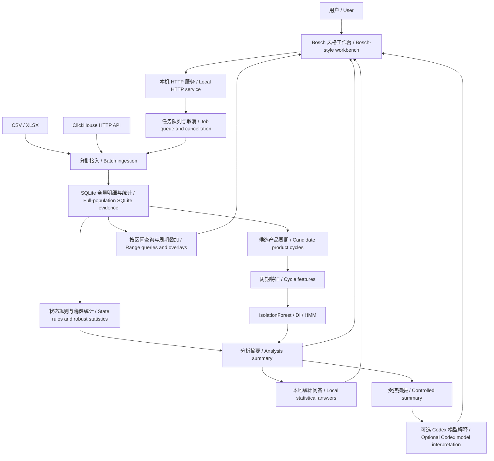

# 伺服与气缸分析 Agent：架构与技术说明
# Servo & Cylinder Analysis Agent: Architecture and Technical Reference

**版本日期 / Version date:** 2026-10-29  
**依据 / Basis:** 当前工作区代码；文档整理未重新运行分析或测试。 / Current workspace source code; no analysis or tests were rerun for this documentation task.  
**范围 / Scope:** 本地 Web 分析工作台、统计与周期模型、问答引擎、数据接入和运行维护。 / Local web workbench, statistical and cycle models, answer engines, data ingestion, and operations.

> **中文：** 本文中的“Agent”指面向设备分析的整体应用及其功能模块。当前实现为固定分析流水线、本地规则问答及可选大模型解释，没有多个自主 Agent 之间的调度、协商或任务委派。
>
> **English:** “Agent” refers to the equipment-analysis application and its functional modules. The implementation combines a fixed analytical pipeline, local rule-based answers, and optional language-model interpretation. It does not implement autonomous multi-agent scheduling, negotiation, or delegation.

## 目录 / Contents

1. [项目定位 / Purpose](#1-项目定位--purpose)
2. [架构 / Architecture](#2-架构--architecture)
3. [模块职责 / Module responsibilities](#3-模块职责--module-responsibilities)
4. [数据接入与字段 / Data sources and fields](#4-数据接入与字段--data-sources-and-fields)
5. [执行流程 / Execution flow](#5-执行流程--execution-flow)
6. [产品周期 / Product cycles](#6-产品周期--product-cycles)
7. [描述性分析 / Descriptive analysis](#7-描述性分析--descriptive-analysis)
8. [诊断分析 / Diagnostic analysis](#8-诊断分析--diagnostic-analysis)
9. [退化指数 / Degradation index](#9-退化指数--degradation-index)
10. [生命周期 / Lifecycle states](#10-生命周期--lifecycle-states)
11. [预测准备度 / Prediction readiness](#11-预测准备度--prediction-readiness)
12. [问答与模型选择 / Answers and model selection](#12-问答与模型选择--answers-and-model-selection)
13. [Web 与接口 / Web and API](#13-web-与接口--web-and-api)
14. [大数据与性能 / Scale and performance](#14-大数据与性能--scale-and-performance)
15. [输出与日志 / Outputs and logging](#15-输出与日志--outputs-and-logging)
16. [运行与维护 / Running and maintenance](#16-运行与维护--running-and-maintenance)
17. [限制与后续方向 / Limitations and next steps](#17-限制与后续方向--limitations-and-next-steps)
18. [源码索引 / Source index](#18-源码索引--source-index)

## 1. 项目定位 / Purpose

**中文：** 项目服务于产线伺服与气缸运行监控，将 CSV、XLSX 或 ClickHouse 数据转成可查看、可追溯的描述统计、异常线索、候选产品周期及相对生命周期状态，并通过问答解释已有结果。当前属于用户主动触发的数据窗分析，尚非持续订阅 PLC 信号的实时闭环控制系统。

**English:** The project supports production-line servo and cylinder monitoring. It transforms CSV, XLSX, or ClickHouse data into inspectable descriptive statistics, anomaly signals, candidate product cycles, and relative lifecycle states, with question answering over computed results. It currently analyzes user-selected data windows; it is not a continuous PLC subscription or closed-loop control system.

| 方向 / Area | 当前能力 / Implemented capability | 解读边界 / Interpretation boundary |
|---|---|---|
| 描述 / Descriptive | 全量统计、时间趋势、周期叠加 / Full-population statistics, time trends, cycle overlays | 图点为聚合值 / Chart points are aggregates |
| 诊断 / Diagnostic | 状态规则、MAD、IsolationForest、DI / State rules, MAD, IsolationForest, DI | 筛查结果，不是确认故障 / Screening, not confirmed faults |
| 生命周期 / Lifecycle | 三状态 Gaussian HMM / Three-state Gaussian HMM | 相对波形状态 / Relative waveform states |
| 预测 / Predictive | 数据准备度检查 / Data-readiness checks | 当前无数值 RUL / No numerical RUL output |
| 问答 / Answers | 本地规则与可选模型解释 / Local rules and optional model interpretation | 解释已有摘要 / Explains existing summaries |

## 2. 架构 / Architecture



**中文：** 原始记录与数值模型在本地处理。大模型不是统计计算的依赖，也不直接对源数据库执行 SQL。界面缩放从保存的 SQLite 明细重新聚合，不重新拟合模型。

**English:** Raw records and numerical models are processed locally. A language model is optional and does not execute SQL against the source database. Zooming reaggregates retained SQLite evidence without refitting models.

## 3. 模块职责 / Module responsibilities

以下为逻辑职责划分，不代表独立运行的多个自主 Agent。 / These are logical responsibilities, not separate autonomous agents.

| 模块 / Module | 输入 / Input | 职责与输出 / Responsibility and output | 主要实现 / Implementation |
|---|---|---|---|
| Web 编排 / Web orchestration | 用户操作 / User actions | 会话、任务、结果、取消 / Sessions, jobs, results, cancellation | `server.py`, `main_web.py` |
| 数据接入 / Ingestion | 文件或数据库选择 / File or database selection | 分批 DataFrame / Batched DataFrames | `local_source.py`, `clickhouse_source.py` |
| 全量统计 / Population statistics | 所有输入批次 / All input batches | 标准化、质量检查、规则与基线 / Normalization, quality checks, rules, baselines | `disk_analysis.py` |
| 流程协调 / Pipeline coordination | 数据流 / Data stream | 串联统计、周期与持久化 / Coordinates statistics, cycles, persistence | `analysis.py` |
| 周期识别 / Cycle segmentation | 时序运动证据 / Time-ordered motion evidence | 候选产品周期 / Candidate product cycles | `product_cycles.py`, `equipment_analysis.py` |
| 特征计算 / Feature extraction | 周期内波形 / Within-cycle signals | 转矩、速度、时长等特征 / Torque, velocity, duration features | `cycle_features.py` |
| 周期模型 / Cycle models | 完整周期特征 / Complete-cycle features | IF 分数、DI、HMM 状态 / IF scores, DI, HMM states | `wave_models.py` |
| 图表查询 / Chart queries | 资产、时间、设备类型 / Asset, time, family | 时间桶统计、周期叠加 / Time-bucket statistics, overlays | `chart_queries.py`, `equipment_analysis.py` |
| 问答 / Answering | 问题与分析结果 / Question and result | 规则答案或可选模型解释 / Rule-based answer or model interpretation | `server.py`, `agent_models.py` |
| 模型桥接 / Model bridge | 模型选项、摘要 / Model settings, summary | 本机 Codex app-server 会话 / Local Codex app-server session | `codex_runtime.py` |
| 日志 / Logging | 运行事件、脱敏错误 / Runtime events, sanitized errors | 原 Logger 格式日志 / Logs using the existing Logger | `src/web_logging.py`, `src/logger.py` |

**中文：** `src/analysis_agent.py` 保留 DataFrame 离线分析、字段定义及辅助函数；Web 大数据主链路使用 `DiskAnalysis`，不能把早期离线流程视为全部 Web 功能。

**English:** `src/analysis_agent.py` retains DataFrame-based offline analysis, field definitions, and helpers. The main large-data web path uses `DiskAnalysis`; the earlier offline implementation is not the complete web application.

## 4. 数据接入与字段 / Data sources and fields

### 4.1 本地文件 / Local files

**中文：** 支持 CSV 与 XLSX，可选择文件、填写本机绝对路径或选择项目 `data/input` 文件。CSV 支持 UTF-8、GB18030；XLSX 可选择工作表，首行应为字段名。浏览器选择文件时会将副本写到本机临时目录；超大文件可填写绝对路径以避免额外复制。应用不设置文件大小或输入行数上限，资源仍受磁盘、内存和读取库限制。

**English:** CSV and XLSX inputs can be selected through a file picker, an absolute local path, or the project’s `data/input` catalog. CSV supports UTF-8 and GB18030; XLSX supports sheet selection and expects field names in the first row. Browser-selected files are copied to a local temporary directory. An absolute path avoids this extra copy for large files. There is no application-level input size or row cap, but hardware and reader-library limits still apply.

### 4.2 ClickHouse

**中文：** 使用标准 HTTP/HTTPS API、`X-ClickHouse-User` / `X-ClickHouse-Key` 和 JSONEachRow。查询按时间窗、可选站点值筛选，仅读取分析所需字段，使用参数绑定和只读设置。时间过滤为左闭右开。应用不附加 LIMIT，并请求解除相关扫描、结果大小及执行时间上限；数据库权限、集群、代理的约束仍可能生效。300 秒为网络无响应超时，不代表整个分析仅可运行 300 秒。

**English:** The connector uses the standard HTTP/HTTPS API, `X-ClickHouse-User` / `X-ClickHouse-Key`, and JSONEachRow. Queries select analytical fields, filter by a half-open time window and optional station value, and use bound parameters and read-only settings. The application adds no LIMIT and requests removal of relevant scan, result-size, and execution-time caps. Database, cluster, or proxy constraints may still apply. The 300-second network inactivity timeout is not a total analysis-duration limit.

### 4.3 字段与粒度 / Fields and grain

| 类别 / Category | 字段 / Fields | 用途 / Use |
|---|---|---|
| 时间 / Time | `MSG_TIMESTAMP` | 排序、时间窗口与采样间隔 / Ordering, windows, sampling intervals |
| 分组 / Grouping | `PRODUCTTEAM`, `MACHINETYPE`, `LINENAME`, `STATIONNAME`, `MESSAGENAME` | 构造资产/站点组 / Build asset or station groups |
| 伺服反馈 / Servo feedback | `ACTTORQUE`, `ACTVEL`, `ACTPOS`, `TARGETPOS` | 转矩、速度、位置及跟随误差 / Torque, velocity, position, following error |
| 指令设定 / Setpoints | `SPEED`, `ACC`, `DEC` | 工况与周期特征 / Operating context and cycle features |
| 状态 / State | `EXEUTE` 或 / or `EXECUTE`, `STANDSTILL`, `ACCELERATING`, `DECELERATING` | 执行/运动状态与特征筛选 / Execution and motion context |
| 诊断 / Diagnostics | `CLASS1DIAG`, `CLASS2DIAG`, `CLASS3DIAG`, `DIAGNO` 等 / etc. | 状态规则及复核依据 / State rules and review evidence |
| 气缸 / Cylinder | `MOVETOTBASTIME`, `MOVETOWORKTIME`, `MOVEMENTCOUNTER` | 行程时间与动作计数 / Travel times and movement counter |
| 时长 / Durations | `ACTTIME` 及其他 LTIME 字段 / and other LTIME fields | 解析到毫秒 / Parse into milliseconds |

**中文：** `POSITION_ERROR = TARGETPOS − ACTPOS`。参数字典 `param_name_and_type.xlsx` 用于解释字段，不自动提供可靠的故障阈值或物理单位转换。组合资产键未必能唯一对应某个轴或气缸。重复记录会统计并保留，不自动当作无效数据删除。

**English:** `POSITION_ERROR = TARGETPOS − ACTPOS`. The `param_name_and_type.xlsx` dictionary supplies metadata; it does not automatically establish fault thresholds or convert physical units. A composite asset key may not uniquely identify an individual axis or cylinder. Duplicate records are counted and retained rather than automatically removed.

## 5. 执行流程 / Execution flow

1. **选择并检查数据源 / Select and inspect the source.** 确定文件、工作表或数据库时间范围。 / Select a file, sheet, or database time window.
2. **分批读取 / Read in batches.** 默认每批 10,000 行，全部批次继续处理。 / The default is 10,000 rows per batch; every batch is processed.
3. **标准化并写盘 / Normalize and spool to disk.** 统一字段名、时间、数值、布尔值、LTIME 和资产键。 / Normalize field names, times, values, booleans, LTIME, and asset keys.
4. **全窗统计与规则 / Compute full-window statistics and rules.** 建立同资产/工况基线，统计质量及异常快照。 / Build asset/context baselines and count quality issues and anomaly snapshots.
5. **识别候选产品周期 / Segment candidate product cycles.** 按时序运动证据分组，标记不完整片段。 / Group motion evidence and mark incomplete segments.
6. **计算特征与模型 / Compute features and models.** 完整周期进入适用的 IF、DI、HMM 流程。 / Eligible complete cycles enter IF, DI, and HMM processing.
7. **保存证据与摘要 / Persist evidence and summaries.** SQLite 保存明细和模型结果，JSON 保存分析摘要。 / SQLite stores evidence and model results; JSON stores summaries.
8. **按需展示与问答 / Query views and answer questions.** 时间缩放重新聚合；问答使用已有结果。 / Zooming reaggregates data; answers use existing results.

**中文：** 后台队列使用单个工作线程，重任务顺序执行；HTTP 服务可同时响应页面和任务状态。取消或读取失败不发布部分分析结果。

**English:** A single worker executes queued background jobs sequentially while the threaded HTTP service handles UI and status requests. Cancellation or read failure does not publish a partial analysis result.

## 6. 产品周期 / Product cycles

### 6.1 业务定义 / Business definition

**中文：** 同一工位开始处理当前产品，到开始处理下一产品之间的完整时间，包含运行、等待、保持和返回。当前字段没有已确认的产品 ID 或循环启动信号，所以实现的是这个业务定义的**候选波形分组**，并非已验证的产品计数。

**English:** A product cycle runs from the start of processing one product at a station to the start of processing the next, including operation, waiting, holding, and return. Since the current schema lacks a verified product ID or cycle-start marker, the implementation provides **candidate waveform groups**, not validated product counts.

```text
候选起点 A / Candidate start A                 候选起点 B / Candidate start B
|----运行 / run----保持 / hold----返回 / return----等待 / wait----|
|---------------- 候选产品周期 / Candidate product cycle --------|
```

### 6.2 当前算法 / Current algorithm

**中文：**

1. 每个资产独立计算边界；同一资产中的伺服与气缸复用同一运动证据和静止阈值。
2. 优先使用实际速度 `ACTVEL`；运动阈值为 `max(1e-8, 0.02 × P95(|ACTVEL|))`。若速度不可用或缺乏有效运动，则依次尝试有变化的 `STANDSTILL`、气缸计数递增证据。
3. 收集连续静止段时长，选取不少于 0.5 秒的时长排序。在相邻时长中寻找最大倍率间隙，当前代码要求倍率严格大于 4；阈值取两端的几何中点 `sqrt(d_short × d_long)`。
4. 没有明显分群时使用假设静止阈值 10 秒；页面披露来源和阈值。
5. 静止达到阈值后的首次运动视为候选起点。到下一候选起点之间的短暂停顿、多次运动和尾部等待都属于同一周期。
6. 采样断档阈值为 `max(30 秒, 10 × 正采样间隔中位数)`；断档和未知运动状态会打断完整性，不能当作已确认的生产等待跨接。
7. 最初尚无确认起点、以及最后尚无下一起点的片段不进入周期模型。

**English:**

1. Boundaries are computed independently per asset. Servo and cylinder views within the same asset reuse the same motion evidence and idle threshold.
2. Actual velocity `ACTVEL` is preferred, using `max(1e-8, 0.02 × P95(|ACTVEL|))` as the motion threshold. Fallbacks are a changing `STANDSTILL` signal and then movement-counter increments.
3. Continuous idle durations of at least 0.5 seconds are sorted. The largest adjacent duration ratio is selected if it is strictly greater than four. The idle threshold is the geometric midpoint, `sqrt(d_short × d_long)`.
4. If durations do not clearly separate, the assumed threshold is 10 seconds. The UI discloses the source and threshold.
5. The first motion after sufficient idle time becomes a candidate start. Short pauses, multiple movements, and trailing waiting time remain in the same cycle until the next candidate start.
6. Acquisition gaps exceeding `max(30 seconds, 10 × median positive sample interval)` and unknown motion states break completeness; they are not bridged as confirmed production waiting.
7. The initial segment without a confirmed start and the final segment without a closing next start are excluded from cycle models.

**中文：** EXECUTE 上升沿不再单独切分产品周期。产品中途长暂停可能造成误切，连续无停顿生产可能合并多个产品；低速运动也可能受阈值影响。当前没有页面手动校正周期或静止阈值的功能。获取工位循环启动、产品 ID、产品类型与维护事件是后续确认边界的关键。

**English:** EXECUTE rising edges no longer independently split product cycles. A long pause within a product may cause a false split, while uninterrupted production may merge products. Low-speed motion can also be affected by the threshold. Manual cycle correction and an editable idle-threshold control are not currently implemented. Station cycle starts, product IDs/types, and maintenance events are needed to validate boundaries.

### 6.3 计数口径 / Counting scopes

| 页面项 / UI item | 定义 / Definition |
|---|---|
| 相交候选产品周期 / Intersecting candidate cycles | 周期与视图区间有重叠，含接触边界 / Overlaps the view, including boundary contact |
| 完整候选产品周期 / Complete candidate cycles | 已标记完整且起点位于视图中；结束可在视图外 / Marked complete and starts in view; may end outside it |
| 叠加图周期 / Overlay cycles | 已完整，且起点和终点均在视图内 / Complete and fully contained in the view |

**中文：** 这些数字可能不同。更新周期算法后，旧结果不会自动重算，需要重新运行完整分析。

**English:** These counts can differ. Existing results are not automatically migrated when segmentation changes; a full analysis must be rerun.

## 7. 描述性分析 / Descriptive analysis

**中文：** 伺服、气缸分别展示。时间趋势每个点代表一个时间桶，最多 500 桶；该桶所有有效记录参与统计。缩放改变桶宽，因此统计曲线细节会改变。

**English:** Servo and cylinder views are separate. Each time-trend point represents a time bucket, with up to 500 buckets. All valid records within a bucket contribute. Zooming changes bucket width and therefore the detailed statistical curves.

| 指标 / Statistic | 含义 / Meaning |
|---|---|
| 中位数 / Median | 典型水平，对尖峰较稳健 / Typical level, less sensitive to spikes |
| 均值 / Mean | 全部有效值平均，受极端值影响 / Average of valid values, sensitive to extremes |
| P05 / P95 | 分布两端，中间约90%的观测范围 / Distribution quantiles enclosing approximately the middle 90% |
| 最小 / 最大 / Min / Max | 桶内极端值 / Within-bucket extremes |
| 标准差 / Standard deviation | 总体标准差，`ddof=0`，与信号同单位 / Population standard deviation, `ddof=0`, in signal units |

**中文：** 分位数采用线性插值；P05/P95 不是置信区间或设备公差。扭矩趋势保留正负号，不自动转成绝对值；均值接近零不代表无负载。缺失桶不按零填补，明显时间空档不跨接连线。

**English:** Quantiles use linear interpolation. P05/P95 are not confidence intervals or equipment tolerances. Torque trends retain their sign; a near-zero mean does not imply zero load. Missing buckets are not filled with zeros, and clear temporal gaps are not bridged.

**中文：** 周期叠加图以起点对齐到0秒，保留真实时长；每周期最多160桶，均值线与最小—最大值淡色标记一起显示。每批最多200周期，可翻页；颜色仅区分曲线。蓝白背景区分相邻周期，无健康含义；超过1000个相交周期时背景暂不绘制，需放大查看。

**English:** Cycle overlays align starts at zero seconds and retain real durations. Each cycle has up to 160 buckets, with a mean line and faint min–max marks. Up to 200 cycles are shown per page. Curve colors identify traces, not health. Alternating blue/white time backgrounds identify adjacent cycles; backgrounds are suppressed above 1,000 intersecting cycles until zoomed in.

## 8. 诊断分析 / Diagnostic analysis

### 8.1 逐行规则 / Row-level rules

**中文：** 状态位规则检查驱动诊断、使能但未就绪、未回参考点等信号。数值筛查使用同资产/工况的中位数与 MAD，稳健 Z 阈值为3.5；MAD为零时使用标准差。动作时间采用单侧上限 `median + max(5.2 × MAD, 0.1 × |median|)`。这些是当前数据窗的筛查阈值，需要设备语义与现场确认。

**English:** State rules inspect drive diagnostics, enabled-but-not-ready conditions, and unreferenced axes. Numerical screening uses asset/context medians and MAD with a robust Z threshold of 3.5, falling back to standard deviation when MAD is zero. Timing uses the one-sided bound `median + max(5.2 × MAD, 0.1 × |median|)`. These window-derived screening thresholds require equipment-specific interpretation.

### 8.2 周期级 IsolationForest / Cycle-level IsolationForest

| 项目 / Item | 实现 / Implementation |
|---|---|
| 最小周期数 / Minimum cycles | 30个完整周期 / 30 complete cycles |
| 伺服特征 / Servo features | 转矩幅度、速度不稳定度、转矩/速度均值、SPEED/ACC/DEC、速度差分加减速度、周期时长 / Torque amplitude, velocity instability, torque/velocity means, setpoints, velocity-derived acceleration/deceleration, duration |
| 气缸特征 / Cylinder features | 工作时间、回程时间、周期时长 / Work time, return time, duration |
| 特征资格 / Feature eligibility | 训练有效值至少 `max(10, 50%训练周期)`，且存在变化 / At least `max(10, 50% of training cycles)` valid values, with variation |
| 训练 / Training | 按时间均匀抽取最多约10,000周期 / Time-spaced sample of up to approximately 10,000 cycles |
| 参数 / Parameters | `n_estimators=100`, `max_samples≤256`, `contamination='auto'`, `random_state=42`, `n_jobs=1` |
| 缺失值 / Missing values | 训练中位数填补；评分周期至少有两个所选特征有效 / Training-median imputation; at least two observed selected features per scored cycle |
| 评分 / Score | `−decision_function`；大于0为异常 / `−decision_function`; positive values are flagged |
| 展示 / Display | 时间桶最高异常分数，红点表示桶内含异常周期 / Maximum score per bucket; red dots indicate anomalous cycles in the bucket |

**中文：** IF 是多变量“不常见程度”检测，不给出已确认的故障原因；一个周期异常不表示每个输入字段均异常。逐行异常快照数、IF异常周期数、独立故障数是不同粒度，不能直接相加或互换。

**English:** IF detects unusual multivariate combinations; it does not establish fault causes or imply every input feature is abnormal. Row-level anomaly snapshots, anomalous cycles, and independent faults are different grains and must not be added or treated interchangeably.

## 9. 退化指数 / Degradation index

**中文：** 当前仅伺服使用扭矩和速度组合的 DI；气缸缺少对应波形时不套用此公式。当前实现的周期模型入口先检查至少30个完整周期，不足时DI也不可用。

**English:** The combined torque/velocity DI currently applies to servos only. It is not applied to cylinders lacking equivalent signals. The model entry point requires at least 30 complete cycles; DI is also unavailable below this gate.

```text
A = P95(|torque| during motion) − P05(|torque| during motion)
V = weighted within-group velocity standard deviation / mean absolute velocity
D(x) = 100 × [1 − exp(−max(0, x / x_ref − 1))]
mean_degradation = [D(A) + D(V)] / 2
```

**中文：** 速度不稳定度只使用非加减速的运动段，按速度设定、运动方向分组，组内至少3点。参考为最早20%完整周期、至少10周期；同SPEED/ACC/DEC组合至少5个参考周期，采用参考中位数。参考为零、工况不匹配或缺少稳定速度时不以零代替缺失；只有两个分量都有效才计算均值，页面显示有效周期分母。

**English:** Velocity instability uses moving segments outside acceleration/deceleration, grouped by speed setpoint and direction, with at least three observations per group. References use the earliest 20% of complete cycles, with at least ten cycles overall and five reference cycles per SPEED/ACC/DEC combination. Reference values are medians. Zero references, unmatched contexts, or missing stable velocity remain unavailable. Both components must exist for the mean DI; the UI reports eligible-cycle counts.

**中文：** DI为30不表示磨损30%或故障概率30%。早期参考未必健康，负载、产品、配方变化均可能影响指标。当前周期层面SPEED/ACC/DEC由周期均值汇总；多指令产品周期内的复杂配方仍可能混合，需要进一步建立工艺阶段和产品类型条件。

**English:** A DI of 30 does not mean 30% wear or 30% failure probability. Early references are not necessarily healthy, and load, product, or recipe changes can affect the index. SPEED/ACC/DEC are currently summarized as cycle means, which can mix complex recipes within multi-command product cycles. Product-type and process-phase conditioning remains a further improvement.

## 10. 生命周期 / Lifecycle states

**中文：** 本地实现三状态对角高斯HMM，使用Baum–Welch EM拟合和Viterbi解码。状态按平均标准化特征水平排序，命名为阶段0（健康）、1（退化）、2（高危）。这些名称是相对状态标签，不是已验证的设备真实寿命阶段。

**English:** A locally implemented three-state diagonal Gaussian HMM uses Baum–Welch EM and Viterbi decoding. States are ordered by average standardized feature level and labeled stage 0 (healthy), 1 (degraded), and 2 (high risk). These are relative state labels, not validated physical life stages.

- **输入 / Inputs:** 伺服优先转矩幅度与速度不稳定度，稳定速度覆盖不足时明确降为仅转矩；气缸使用工作/回程时间和周期时长。 / Servos prefer torque amplitude and velocity instability, with an explicitly disclosed torque-only fallback; cylinders use work/return times and duration.
- **资格 / Eligibility:** 至少30个特征完整周期、足够变化和至少三种不同特征组合。 / At least 30 feature-complete cycles, sufficient variation, and at least three distinct feature combinations.
- **训练 / Training:** 最多10个连续块，每块最多500周期；分块间不学习人为连续转移。 / Up to ten contiguous blocks of 500 cycles each; no artificial transitions across separate blocks.
- **推断 / Inference:** 对全部有效周期解码，缺失周期及断档重置序列；允许状态恢复。 / Decode all eligible cycles, reset across missing cycles or gaps, and allow state recovery.
- **图表 / Charts:** 红色半透明区间对应阶段2；粗时间桶阶段线取最高阶段。 / Translucent red bands mark stage 2; coarse bucket lines show the maximum stage.

**中文：** 红区不是“进入即极易出次品”的证据，没有逐周期质量标签时无法给出次品概率。HMM健康标签也不是安全证明。另有兼容的资产筛查分，基于异常快照占比，与HMM不是同一模型。

**English:** Red bands do not establish a high defect probability without cycle-level quality labels. A healthy HMM label is not a safety certification. A retained asset screening score based on anomaly-snapshot rates is a separate heuristic, not the HMM.

## 11. 预测准备度 / Prediction readiness

**中文：** 当前只检查数据条件，不训练RUL模型，即使返回 `eligible_for_model_review`，`rul_estimate` 仍为 `None`。检查包括独立资产ID、累计年龄、失效/更换事件列、至少30条识别事件记录及至少30天观察窗。这些是应用初筛门槛，不等于可靠性建模充分条件；事件行也可能重复，需要进一步核实独立失效。

**English:** The application checks readiness but does not train a RUL model. Even `eligible_for_model_review` leaves `rul_estimate` as `None`. Checks include unique asset IDs, age, failure/replacement fields, at least 30 detected event rows, and a 30-day window. These are preliminary application gates, not proof of modeling sufficiency; repeated event rows require reconciliation into independent failures.

| 候选方向 / Candidate approach | 所需补充数据 / Additional data required |
|---|---|
| Weibull / 生存分析 / Survival analysis | 多设备年龄、失效与删失状态 / Multi-asset ages, failures, censoring |
| 健康阈值到达时间 / Health-threshold crossing | 长期稳定趋势与验证阈值 / Long-term trends and validated thresholds |
| XGBoost / 时序模型 / Time-series models | 足量生命周期、标签、无泄漏时间验证 / Sufficient lifecycles, labels, leakage-free temporal validation |

## 12. 问答与模型选择 / Answers and model selection

### 本地问答 / Local answers

**中文：** 默认模型标识 `local-statistical-v1`，使用问题关键词和当前运行摘要生成答案，无需外部模型。它没有开放式推理工具循环，不会根据任意问题自动重查ClickHouse。答案的证据范围是当前分析结果，不应假设问答自动跟随每个缩放图的局部区间。

**English:** The default `local-statistical-v1` engine uses question keywords and the current run summary without an external model. It has no open-ended tool loop and does not automatically requery ClickHouse for arbitrary questions. Its evidence scope is the current analytical result, not automatically every zoomed chart interval.

### 可选模型解释 / Optional model interpretation

**中文：** `AnswerModels`通过`CodexBridge`连接本机Codex app-server，动态读取模型列表，传递模型、推理强度和速度选项。发送前要求页面确认，模型收到用户问题及受控摘要，不直接收到原始文件、逐行记录或数据库连接信息。失败会明确提示，不静默改用另一模型。

**English:** `AnswerModels` connects through `CodexBridge` to the local Codex app-server, dynamically retrieves available models, and forwards model, reasoning-effort, and speed settings. Sending requires explicit UI consent. The selected model receives the question and a controlled summary, not raw files, row-level evidence, or database credentials. Failures are reported without silent model substitution.

**中文：** 摘要包括顶层统计、异常标记计数、部分资产筛查摘要、预测准备度以及有限的周期模型摘要；去除文件名、资产标识和原始参数样例，但不能将其视为形式化匿名化证明。用户自己写入问题的敏感信息仍可能发送给所选模型。

**English:** The summary includes top-level statistics, anomaly-flag counts, limited asset-screening summaries, readiness, and limited cycle-model summaries. Filenames, asset identifiers, and raw examples are excluded, but this is not a formal anonymization guarantee. Sensitive details typed into the question can still be sent to the selected model.

**中文：** 桥接使用临时目录、只读沙箱、临时会话和空动态工具列表，工具请求不获执行权限。模型不会承担直接设备控制或自动维护决策。此处描述的是项目源码集成方式，不代表对外部服务能力或保留策略的独立认证。

**English:** The bridge uses a temporary workspace, read-only sandbox, ephemeral sessions, and an empty dynamic-tool list; tool requests are not granted execution. The model does not control equipment or autonomously make maintenance decisions. These are source-level integration properties, not an independent certification of external services or their retention policies.

### 语音输入 / Voice input

**中文：** 语音转文字填入输入框，不自动发送。离线模式依赖浏览器本地识别和语言包；浏览器联网语音服务需要单独选择与确认。后端不保存录音。兼容性、麦克风权限和识别质量由浏览器与设备共同决定。

**English:** Dictation fills the text box without submitting it. Offline recognition depends on browser support and language packs; online browser speech services require separate selection and consent. The backend does not store recordings. Availability and quality depend on browser support, permissions, and hardware.

## 13. Web 与接口 / Web and API

**中文：** 前端为原生HTML/CSS与ES Modules，沿用Web_Framework的Bosch本地素材和布局。数据栏、分析区、Agent侧栏支持响应式抽屉及专注模式。伺服、气缸在描述、诊断、生命周期页分区。

**English:** The frontend uses native HTML/CSS and ES Modules with local Bosch assets and the Web_Framework layout. The data panel, analytical workspace, and Agent panel support responsive drawers and focus mode. Descriptive, diagnostic, and lifecycle tabs separate servos from cylinders.

| 方法 / Method | 路径 / Path | 用途 / Purpose |
|---|---|---|
| GET | `/api/health` | 服务标识与会话令牌 / Service identity and session token |
| GET | `/api/datasets` | 项目文件目录 / Project dataset catalog |
| POST | `/api/local/project` | 注册项目文件 / Register project file |
| POST | `/api/local/register` | 注册绝对路径 / Register absolute path |
| POST | `/api/local/upload` | 上传副本至本机 / Copy selected file to local service |
| POST | `/api/analyze` | 排队本地分析 / Queue local analysis |
| POST | `/api/clickhouse/connect` | 检查连接及字段 / Check connection and schema |
| POST | `/api/clickhouse/analyze` | 排队数据库分析 / Queue database analysis |
| GET | `/api/jobs/{job_id}` | 任务进度与结果 / Job progress and result |
| POST | `/api/jobs/{job_id}/cancel` | 请求取消 / Request cancellation |
| POST | `/api/equipment/{run_id}` | 图表、周期、资产搜索 / Charts, cycles, asset search |
| GET | `/api/models` | 模型目录 / Model catalog |
| POST | `/api/models/connect` | 连接本机模型运行程序 / Connect local model runtime |
| POST | `/api/ask` | 本地或模型问答 / Local or model-backed answers |

**中文：** 接口不是无鉴权公开服务。服务绑定`127.0.0.1`，检查Host、Origin和会话令牌。运行ID必须属于当前服务会话。连接凭据仅存当前进程内存，重启后须重新连接；不要将服务直接暴露给产线网络或公网作为已完成的企业权限系统。

**English:** These endpoints are not an unauthenticated public API. The service binds to `127.0.0.1` and checks Host, Origin, and session tokens. Run IDs must belong to the current session. Connection credentials remain in process memory and must be reentered after restart. The local service is not a completed enterprise access-control system for network exposure.

## 14. 大数据与性能 / Scale and performance

| 机制 / Mechanism | 作用与边界 / Purpose and boundary |
|---|---|
| 10,000行读取批次 / 10,000-row batches | 限制缓冲，不截断输入 / Bounds buffers, not total input |
| SQLite磁盘统计 / Disk-backed statistics | 保留全量证据，避免整表驻留内存 / Retains population evidence without full-table RAM residency |
| 共用有序读取 / Shared ordered reads | 多信号复用资产/时间扫描 / Shares asset/time reads across signals |
| 高密度桶溢写 / Dense-bucket spill | 常规NumPy缓冲，超过50,000行转临时磁盘统计 / NumPy buffer spills beyond 50,000 rows |
| 分组特征计算 / Grouped feature extraction | 避免逐周期重复全表扫描 / Avoids repeated full-table scans per cycle |
| 有界模型训练 / Bounded model training | 训练采样明确披露，全部合格周期推断 / Disclosed bounded training with population inference |
| 前端12项区间缓存 / 12-entry range cache | 重用近期查询，不缓存原始全量数据 / Reuses recent queries, not raw full-population data |
| 心跳与取消 / Heartbeat and cancellation | 显示统计阶段与耗时，可中断任务 / Reports stages and elapsed time; supports cancellation |
| 原子移动保存 / Atomic evidence move | 关闭工作库后同卷移动，避免完整数据库复制 / Moves closed evidence on the same volume without a full copy |

**中文：** 预览资产、异常明细和周期曲线有显示上限，汇总仍按其说明覆盖全量。精确分位数、排序、周期查询会消耗I/O与磁盘；“无限制输入”不是恒定耗时或无限资源承诺。当前主路径包含多个统计与周期阶段，尚无生产级分布式计算、增量常驻模型或长期压测保证。

**English:** Asset, anomaly-detail, and cycle-curve previews are bounded while totals retain their disclosed population scopes. Exact quantiles, sorting, and cycle queries consume I/O and disk. Uncapped input does not promise constant latency or unlimited resources. The current pipeline is not a distributed production engine or a continuously maintained incremental model, and no sustained production-scale benchmark is guaranteed.

## 15. 输出与日志 / Outputs and logging

```text
data/output/
├── web_agent_runs/
│   ├── <run_id>/analysis.json
│   └── <run_id>.wave.sqlite
├── logger/YYYYMMDD.log
└── reports/                         # HTML报告及预览 / HTML reports and previews
```

**中文：** SQLite主要包含`samples`、`wave_assets`、`wave_rows`、`cycles`、`equipment_models`，保存规范化记录、周期映射、特征、分数、阶段及模型元数据。JSON包含描述、诊断、生命周期、预测准备度、数据源与处理耗时。工作临时目录在任务结束清理；最终证据保留，重启后网页会话仍需重新运行建立结果。

**English:** SQLite mainly contains `samples`, `wave_assets`, `wave_rows`, `cycles`, and `equipment_models`, retaining normalized records, cycle mappings, features, scores, stages, and model metadata. JSON holds descriptive, diagnostic, lifecycle, readiness, source, and timing summaries. Working temporary directories are cleaned after tasks; final evidence remains, but the web session requires a new analysis after restart.

**中文：** Web通过`src/web_logging.py`直接复用现有`src/logger.py`的Logger，不改动Logger实现。日志覆盖启动、任务、性能阶段和失败；错误在适配层脱敏，不应记录密码、令牌、原始数据明细或用户问答。保存的SQLite和JSON本身可能含业务数据，应按项目数据权限管理。

**English:** `src/web_logging.py` directly reuses the existing Logger in `src/logger.py` without modifying it. Logs cover startup, jobs, timing stages, and failures, with error sanitization in the adapter. Passwords, tokens, raw records, and user questions should not be logged. Persisted SQLite and JSON evidence may contain business data and require appropriate access controls.

## 16. 运行与维护 / Running and maintenance

### VS Code

**中文：** 打开项目根目录，选择自己管理的Python解释器，在`main_web.py`点击 **Run Python File**。依赖见集成目录`requirements.txt`：NumPy、Pandas、openpyxl、SciPy、scikit-learn。无需固定机器路径或自动创建虚拟环境。

**English:** Open the project root in VS Code, select a user-managed Python interpreter, and use **Run Python File** on `main_web.py`. Dependencies are listed in the integration’s `requirements.txt`: NumPy, Pandas, openpyxl, SciPy, and scikit-learn. No machine-pinned interpreter or automatically provisioned environment is required.

```sh
# 从项目根目录执行 / Run from the project root
python -m pip install -r Web_Framework/source/integrations/servo_cylinder_agent/requirements.txt
python main_web.py
```

**中文：** 默认地址为`http://127.0.0.1:8890/`。保持启动终端运行，Ctrl+C停止。重复启动会打开现有服务，不自动替换旧进程；修改后须停止旧进程再启动。只修改本文档无需重启Web。Codex是可选依赖，必要时用`SERVO_AGENT_CODEX_BIN`指定可执行文件。

**English:** The default URL is `http://127.0.0.1:8890/`. Keep the terminal running and stop with Ctrl+C. Repeated launches open an existing service rather than replacing its process; restart explicitly after code changes. Editing this document alone requires no web restart. Codex is optional; `SERVO_AGENT_CODEX_BIN` can identify its executable when necessary.

| 问题 / Issue | 排查方向 / Investigation |
|---|---|
| 网页打不开 / Page unavailable | 启动终端是否运行、8890端口是否被占用 / Check the process and port occupancy |
| 缺少依赖 / Missing dependencies | 检查VS Code当前解释器，在同一解释器安装requirements / Check the selected interpreter and install dependencies there |
| ClickHouse HTTP 500 / Code 158 | 查看具体错误、账号约束、集群叶节点或代理限制 / Inspect error details, account constraints, leaf nodes, proxies |
| 周期数不符合现场 / Cycle count mismatch | 检查静止阈值、产品类型、运动证据及工位启动信号 / Inspect idle threshold, product mix, motion evidence, station starts |
| HMM / IF数据不足 / Insufficient model data | 查看完整产品周期数及有效特征，不回退到指令数冒充样本 / Check complete product cycles and features; do not substitute command counts |
| 重启后结果失效 / Results invalid after restart | 重新选择数据、连接并分析 / Reselect or reconnect and rerun |

## 17. 限制与后续方向 / Limitations and next steps

**当前限制 / Current limitations**

- 产品周期是启发式候选分组，无产品数量真实性保证。 / Product cycles are heuristic groups, not validated production counts.
- 组合资产键不一定区分单轴与单气缸。 / Composite grouping may not identify individual axes or cylinders.
- HMM标签与DI未用独立质量、磨损或维修标签校准。 / HMM labels and DI lack independent quality, wear, or maintenance calibration.
- 无数值RUL、自动设备控制、自动维修指令或持续告警推送。 / No numerical RUL, equipment control, automatic maintenance commands, or continuous alert delivery.
- 问答为结果解释；当前没有RAG向量库或开放式多工具规划。 / Answers interpret results; there is no RAG vector store or open-ended multi-tool planning.
- 本地HTTP与内存会话不等于多用户生产部署。 / Local HTTP and in-memory sessions are not multi-user production deployment.

**建议演进方向，尚未实现 / Proposed developments, not implemented**

1. 接入独立设备ID、产品ID、工位循环启动、产品类型和质量结果，验证周期对应关系。 / Add unique device IDs, product IDs, station cycle starts, product types, and quality outcomes to validate cycles.
2. 增加可审阅的周期边界修正、阈值配置和工艺阶段分段。 / Add reviewable boundary correction, threshold configuration, and process-phase segmentation.
3. 依产品/配方/负载建立参考，防止工况混合导致异常。 / Condition references on product, recipe, and load to reduce context-driven false alerts.
4. 使用标注数据测量误报、漏报、阶段稳定性及质量关联。 / Evaluate false positives, false negatives, state stability, and quality association using labeled data.
5. 补齐失效、维护和删失历史后，再开展生存分析及RUL时间外验证。 / Develop survival and RUL models only after collecting failures, maintenance, and censoring histories.
6. 按实际数据规模评估增量处理、服务化和存储生命周期。 / Evaluate incremental processing, service deployment, and retention against actual production scale.

## 18. 源码索引 / Source index

以下路径相对项目根目录，按当前实现整理。 / Paths are relative to the project root and reflect the current implementation.

```text
main_web.py                                 VS Code启动入口 / Launcher
src/
  analysis_agent.py                         离线分析与公共定义 / Offline analysis and shared definitions
  logger.py                                 原有日志器 / Existing Logger
  web_logging.py                            Web日志适配 / Web logging adapter
Web_Framework/source/integrations/servo_cylinder_agent/
  server.py                                 HTTP、任务与本地问答 / HTTP, jobs, local answers
  analysis.py                               分析协调与准备度 / Pipeline and readiness
  local_source.py                           CSV/XLSX读取 / File ingestion
  clickhouse_source.py                      ClickHouse接入 / Database ingestion
  disk_analysis.py                          全量磁盘统计 / Population disk statistics
  product_cycles.py                         候选产品分组 / Candidate product grouping
  equipment_analysis.py                     周期分配、证据与区间查询 / Cycle mapping, evidence, range queries
  cycle_features.py                         周期特征 / Cycle features
  wave_models.py                            IF、DI与Gaussian HMM / IF, DI, Gaussian HMM
  chart_queries.py                          时间桶与叠加查询 / Bucket and overlay queries
  agent_models.py                           问答引擎与摘要 / Answer engines and summaries
  codex_runtime.py                          Codex stdio桥接 / Codex stdio bridge
  requirements.txt                          Python依赖 / Python dependencies
  web/
    index.html                              页面结构 / Page structure
    app.js                                  主界面 / Main UI
    equipment.js                            设备图表与交互 / Equipment charts and interactions
    source.js                               数据源交互 / Source interactions
    layout.js                               面板布局 / Panel layout
    voice-input.js, voice-core.js            听写 / Dictation
    style.css, workbench-layout.css          样式 / Styles
    assets/                                 本地品牌素材 / Local brand assets
```

**中文：** 旧README中的按EXECUTE/气缸计数切分段落属于历史版本，应以当前`product_cycles.py`及本文件的产品周期说明为准。文档描述实现与限制，不替代现场设备说明书、工艺定义或模型验证记录。

**English:** Earlier README sections describing EXECUTE-edge or counter-based cycle splitting are historical. Current segmentation is defined by `product_cycles.py` and the product-cycle section above. This document describes implementation and limitations; it does not replace equipment manuals, process definitions, or model-validation records.
